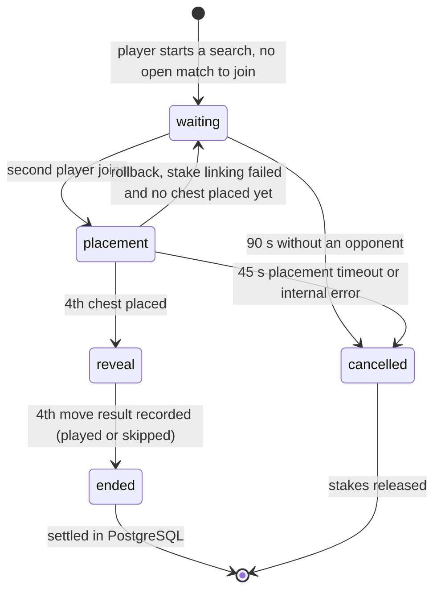
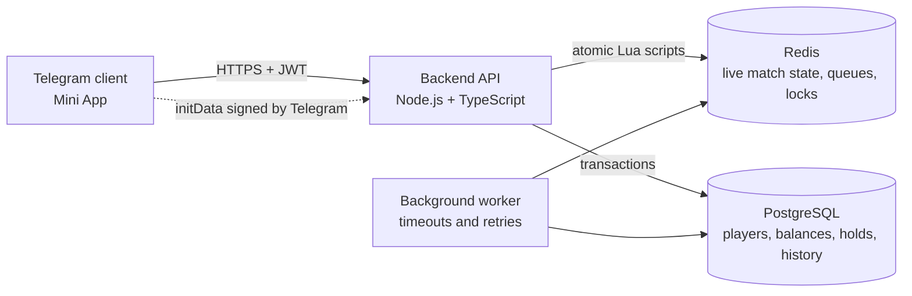
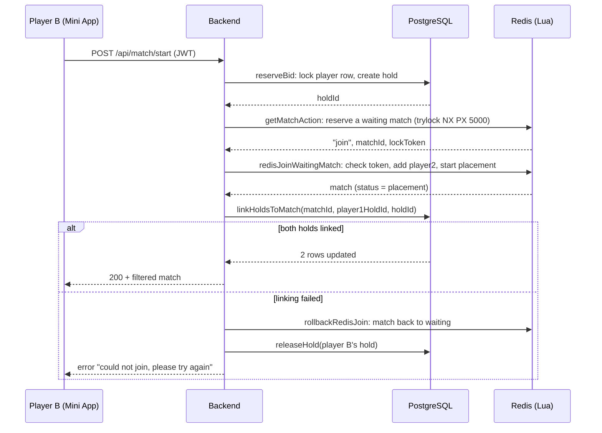
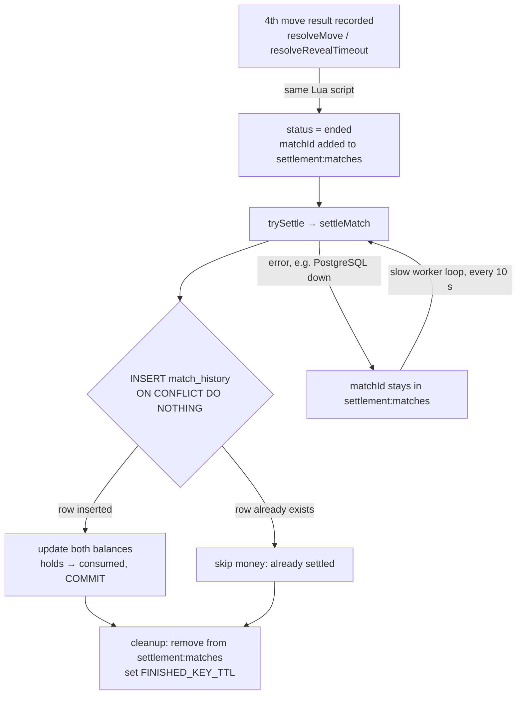

# Treasure Island PvP: Project Map

Treasure Island is a 1v1 PvP game that runs as a Telegram Mini App. This file describes how the game works inside: sign-in, matchmaking, game phases, timeouts, what happens when something crashes, and how a match is paid out.

> Scope: this map covers only the internal logic of the app. External services such as deposits, payment processing, withdrawals and payouts, and other third-party providers are not part of it and will be described in separate documents. The first version runs on test credits.

> Status: this is the design the backend is being built from. The code and its tests have to match what is written here.

## Contents

1. [The game in one minute](#the-game-in-one-minute)
2. [System overview](#system-overview)
3. [Money model](#money-model)
4. [Constants](#constants)
5. [Auth](#auth)
6. [PostgreSQL structure](#postgresql-structure)
7. [Matchmaking](#matchmaking)
8. [Rollbacks and safety net](#rollbacks-and-safety-net)
9. [Responses to the frontend](#responses-to-the-frontend)
10. [Match object](#match-object)
11. [Placement](#placement)
12. [Reveal](#reveal)
13. [Settlement](#settlement)
14. [Worker](#worker)
15. [API](#api)
16. [TODO](#todo)

## The game in one minute

Two players put in the same stake. Each player splits their stake into two hidden chests: a big chest worth 80% of the stake and a small chest worth 20%. Each chest goes into one of five zones on the player's own island.

Then the players take turns opening zones on the opponent's island. Each player gets exactly two moves. A chest you find becomes yours. A chest your opponent fails to find goes back to you. Both players can win something, so there is not always a single winner.

The whole match lives through five statuses:



Rollback (placement back to waiting) happens only when linking the stakes in PostgreSQL failed and no chest has been placed yet. In every cancellation both stakes are released.

One Redis key `match:<matchId>` lives for the whole cycle, and the status changes through `HSET`.

```
match:<id>             main Hash, lives for the whole cycle
match:<id>:placement   separate Hash, appears with the first chest
match:<id>:reveal      separate Hash, appears with the first move
```

## System overview



| Layer      | Owns                                                                                   |
|------------|----------------------------------------------------------------------------------------|
| PostgreSQL | Durable and monetary data: `players`, `balance_holds`, `withdrawals`, `match_history`  |
| Redis      | Live and temporary data: match state, queues, locks, "player -> current match" pointer |
| Frontend   | Only the JWT in memory and the screen; never decides the stake or the `playerId`       |

A few rules hold everywhere in the design:

- The server decides everything. The client only says what the player wants to do; rules, results and payouts are computed on the backend.
- Any "check, then change" on live match state is one Redis Lua script, so two requests can't interleave.
- Money is kept in PostgreSQL and guarded by transactions, row locks and unique constraints, not just by our code.
- Every recovery step can safely run twice. Retries or two workers at once can't pay twice or lose a stake.
- The opponent's chest positions and internal hold IDs never leave the server.

## Money model

A player's result = the opponent's chests they found + their own chests the opponent did not find. The two players' results always add up to 2 × stake.

Profit = result − stake. A 10% fee is taken only from positive profit.

Payout = result − fee. Balance = balance − stake + payout.

## Constants

Time in Redis and Lua is stored in milliseconds (`Date.now()`). Constants are in seconds and are multiplied by 1000 when deadlines are written. Redis key TTLs are set with `EXPIRE` in seconds.

```
MATCH_STAKE = 5
MAX_MATCH_ATTEMPTS = 5
MATCHMAKING_TIMEOUT = 90     // how long we actually wait for an opponent
HOLD_SAFETY_TIMEOUT = 120    // safety net, longer than MATCHMAKING_TIMEOUT
PLACEMENT_TIMEOUT = 45
TURN_TIMEOUT = 30
FEE_PERCENT = 10             // service fee, % of a player's positive profit
MATCH_KEY_TTL = 3600         // seconds, guard against garbage in Redis (value to be confirmed)

FINISHED_KEY_TTL = 600       // seconds, how long finished match keys stay in Redis (settled or cancelled)

WORKER_FAST_INTERVAL = 1     // seconds, worker loop for reveal moves
WORKER_SLOW_INTERVAL = 10    // seconds, all other worker tasks
SETTLEMENT_MAX_FAILS = 10    // consecutive settlement failures before an emergency log entry
JWT_TTL = 600                // seconds
INITDATA_MAX_AGE = 86400     // seconds, maximum age of auth_date
```

## Auth

User sign-in through the Telegram Mini App.

### Auth: main flow

```
user opens the Mini App
→ Frontend reads window.Telegram.WebApp.initData
→ Frontend sends initData in the body of POST /api/auth/telegram
→ Backend runs the handler authTelegram(initData)
Result: the user is authorized, the JWT is held in Frontend memory.
```

### authTelegram(initData)

Auth orchestrator. The only route without `authMiddleware`: a JWT is only issued here.

```
Takes: initData (from the request body)
Does: verifyTelegramInitData(initData, botToken)
    → if an auth error is thrown → HTTP 401, response "signIn error"
    → if any other error is thrown → HTTP 500
    → if the data is valid → gets telegramUser
    → findOrCreatePlayer(telegramUser)
        → if a database error → HTTP 500
        → otherwise gets player
    → issueJWT(player.id)
    → sends the token in the response
Returns: { token } / HTTP 401 / HTTP 500.
```

### Frontend: after the response

```
→ got a token → stores the JWT in RAM
→ got HTTP 401 from /api/auth/telegram → shows "could not sign in";
  retrying with the same initData is pointless
→ got HTTP 500 → retries after a pause, a limited number of times
```

### Using the JWT on every following request

```
Frontend sends the JWT in the header Authorization: Bearer <JWT>
→ the router finds the route, authMiddleware runs
→ if the JWT is invalid or expired → HTTP 401, the handler does not run
→ if the JWT is valid → playerId is stored in req.playerId, the handler runs
→ if the Frontend got HTTP 401 → removes the old JWT from RAM and repeats
  Auth with the same initData
  → if Auth returned a new JWT → repeats the original request once
  → if Auth returned 401 (initData is too old) → asks the user to restart the Mini App
```

### authMiddleware(req, res, next)

JWT check before any handler, except `/api/auth/telegram`.

```
Takes: the request
Does: reads the Authorization header
    → if the header is missing or does not start with "Bearer " → HTTP 401
    → strips "Bearer ", calls verifyJWT(token)
        → if an error is thrown → HTTP 401
        → if a playerId came back → req.playerId = playerId → next()
Returns: passes control to the handler / HTTP 401.
```

The player identifier and the stake come from `JWT.sub` and a constant.

### verifyTelegramInitData(initData, botToken)

```
Takes: initData, botToken
Does:
    → if initData is missing → throw an auth error
    → parses initData
    → extracts receivedHash and removes hash from the parameter set
    → if receivedHash is missing → throw an auth error
    → sorts the remaining parameters by key and builds dataCheckString:
      "key=value" lines joined with \n
    → computes secretKey = HMAC-SHA256(key = "WebAppData", message = botToken)
      ("WebAppData" is a fixed string from the Telegram protocol)
    → computes calculatedHash = HMAC-SHA256(key = secretKey, message = dataCheckString) in hex
    → compares receivedHash and calculatedHash with crypto.timingSafeEqual (after checking that the lengths match)
        → if they do not match → throw an auth error
    → extracts auth_date and telegramUser
    → if auth_date is missing, in the future, or older than INITDATA_MAX_AGE → throw an auth error
    → if telegramUser is missing or telegramUser.id is invalid → throw an auth error
    → if all checks pass → return { telegramUser, authDate }
Returns: { telegramUser, authDate } / throws an auth error
```

### findOrCreatePlayer(telegramUser)

```
Takes: telegramUser (from verifyTelegramInitData)
Does: one PostgreSQL query
    INSERT INTO players (tgid, player) VALUES (telegramUser.id, player name)
    ON CONFLICT (tgid) DO UPDATE SET player = EXCLUDED.player
    RETURNING *
    → if the player did not exist → a new row is created
    → if the player existed → the existing row is returned, the name is updated
Returns: player (existing or just created)
```

### issueJWT(playerId)

```
Takes: playerId
Does: jwt.sign({ sub: String(playerId) }, JWT_SECRET,
    { algorithm: "HS256", expiresIn: JWT_TTL })
Returns: token.
```

### verifyJWT(token)

```
Takes: token (from the Authorization header)
Does: jwt.verify(token, JWT_SECRET, { algorithms: ["HS256"] })
    → if the signature is invalid or exp has passed → throw an auth error
    → if the JWT is valid → playerId = String(payload.sub)
Returns: playerId / throws an error that becomes HTTP 401.
```

### JWT lifecycle and client-side storage

The JWT lives in Frontend RAM, is signed with a server secret (`.env`), contains the `playerId`, and lives for `JWT_TTL` seconds. Re-authorization within one session uses the same initData (initData is not expected to refresh while the app is running) and works as long as that initData is not older than `INITDATA_MAX_AGE`.

```
user closed the app, reopened it, or RAM was cleared
→ the JWT in RAM is empty
→ the user opens the Mini App again
→ Telegram provides fresh initData
→ Frontend checks for a valid JWT in RAM
    → if there is a JWT → uses the current JWT
    → if there is no JWT → sends POST /api/auth/telegram with initData
        → Backend runs Auth and issues a new JWT
        → Frontend stores the new JWT in RAM
```

## PostgreSQL structure

`players.balance` holds the total balance and does not deal with holds. The free balance is computed: `available = balance − SUM(amount of the player's active holds)`.

```sql
CREATE TABLE players (
  id SERIAL PRIMARY KEY,                -- unique player id
  tgid BIGINT UNIQUE NOT NULL,          -- Telegram id, unique, not NULL
  player VARCHAR(255),                  -- player name, up to 255 characters
  balance NUMERIC(12, 2) DEFAULT 0,     -- total balance: 12 digits in total, 2 after the decimal point
  matches INTEGER DEFAULT 0,            -- number of matches
  wins INTEGER DEFAULT 0,               -- number of wins (win = positive profit in a match)
  score INTEGER DEFAULT 0,              -- number of points
  "createdAt" TIMESTAMP DEFAULT NOW(),  -- row creation date
  "lastPlays" TIMESTAMP                 -- date of the last game
);

CREATE TABLE balance_holds (
  id SERIAL PRIMARY KEY,                -- unique hold id
  "playerId" INTEGER REFERENCES players(id), -- link to the players table
  type VARCHAR(20) NOT NULL,            -- what the funds are held for: match_bid | withdrawal
  amount NUMERIC(12, 2) NOT NULL,       -- held amount
  status VARCHAR(20) NOT NULL DEFAULT 'active',  -- active | released | consumed
  "refId" VARCHAR(50),                  -- what the hold is attached to: a match id
                                        -- or a withdrawal request id; NULL until
                                        -- a match is found
  "createdAt" TIMESTAMP DEFAULT NOW(),  -- row creation date
  "expiresAt" TIMESTAMP                 -- when the hold counts as stuck
);

CREATE INDEX idx_holds_player_active ON balance_holds("playerId") WHERE status = 'active';
CREATE INDEX idx_holds_expired ON balance_holds("expiresAt") WHERE status = 'active';
CREATE UNIQUE INDEX unique_active_match_hold_per_player
  ON balance_holds("playerId")
  WHERE status = 'active' AND type = 'match_bid';

CREATE TABLE withdrawals (
  id SERIAL PRIMARY KEY,                -- withdrawal id
  "playerId" INTEGER REFERENCES players(id), -- link to the players table
  amount NUMERIC(12, 2) NOT NULL,       -- withdrawal amount, required
  status VARCHAR(20) NOT NULL DEFAULT 'pending',  -- pending | completed | cancelled
  "createdAt" TIMESTAMP DEFAULT NOW(),  -- row creation date
  "processedAt" TIMESTAMP               -- date the withdrawal was processed
);

CREATE TABLE match_history (
  id SERIAL PRIMARY KEY,                -- history row id
  "matchId" VARCHAR(50) UNIQUE NOT NULL, -- match id, unique, not NULL
  "player1Id" INTEGER REFERENCES players(id), -- first player
  "player2Id" INTEGER REFERENCES players(id), -- second player
  bid NUMERIC(12, 2),                   -- stake
  result VARCHAR(20) NOT NULL,          -- played | cancelled
  "p1Winnings" NUMERIC(12, 2),          -- payout to player 1 after the fee (profit = p1Winnings − bid)
  "p2Winnings" NUMERIC(12, 2),          -- payout to player 2 after the fee
  fee NUMERIC(12, 2),                   -- service fee for the match (revenue = SUM(fee))
  "cancelReason" VARCHAR(100),          -- cancellation reason
  moves JSONB,                          -- move history (placement + reveal), for audit
  "createdAt" TIMESTAMP DEFAULT NOW(),  -- row creation date
  "finishedAt" TIMESTAMP                -- match end date
);
```

Example of `balance_holds` in action:

```
id    playerId   type         amount   status    refId
1     7          match_bid    5.00     active    NULL       // searching for a game, no match yet
1     7          match_bid    5.00     active    'm_ab12'   // after linkHoldsToMatch (same row, id = 1)
2     7          withdrawal   20.00    active    '15'       // id of a withdrawals row
```

There is no foreign key on `refId`: it points either to a match stored in Redis or to a row of another table.

### Indexes

idx_holds_player_active: fast lookup of a specific player's active holds (to compute `available`). Built on `playerId`.

idx_holds_expired: fast lookup of active holds whose `expiresAt` has passed (needed by `checkExpiredHolds`). Built on `expiresAt`.

unique_active_match_hold_per_player: a unique index on `playerId` among rows with `status = 'active' AND type = 'match_bid'`. One player cannot have two active `match_bid` holds at the same time. This rules out a duplicate entry even if the check in `reserveBid` missed a race. There can be any number of `released` and `consumed` rows, and the index does not affect `withdrawal`. A violation of the index is PostgreSQL error `23505`, and `reserveBid` returns it as "already in game".

## Matchmaking

Searching for, creating, and starting a match.

### Redis keys

```
match:<matchId>              Hash, the whole match lifecycle (waiting → placement → reveal → ended or cancelled)
match:<matchId>:placement    Hash, fields p1_big, p1_small, p2_big, p2_small = zoneId (1 to 5)
                             The key appears with the first write (Redis has no empty hashes)
match:<matchId>:reveal       Hash, fields <slot>_move_<n>_zone and <slot>_move_<n>_result (n = 1 or 2)
                             result: hit_big | hit_small | miss | skipped. Also appears with the first write
match:<matchId>:trylock      String, value = lockToken, reserves the match for one search
lock:create                  String, value = createLockToken, the right to create a match
waiting:matches              ZSET, score = createdAt, queue of waiting matches
placement:matches            ZSET, score = placementDeadline, matches in the placement phase
reveal:matches               ZSET, score = turnDeadline, matches in reveal (waiting for a player's move)
settlement:matches           ZSET, score = game end time, matches waiting for settlement in PostgreSQL
player:<playerId>:currentMatch   String = matchId, any live match of the player
```

The ZSETs don't hold match data, they work like an index. The data lives in the match keys, and a ZSET lets the backend or the worker find the right matches with one command. For example, `ZRANGEBYSCORE reveal:matches -inf <now>` returns exactly the matches whose turn deadline has passed.

`match:<matchId>` is created with TTL `MATCH_KEY_TTL` (guard against garbage). The end of waiting is decided by `checkMatchmakingTimeout`. The `:placement` and `:reveal` keys get their TTL in the same Lua scripts right after each write (`EXPIRE MATCH_KEY_TTL`): the key only appears with the first write, and if the match never finishes, it will not stay forever.

When a match is finished (settled in `settleMatch` or cancelled by a Lua cancel function), all its existing keys get TTL `FINISHED_KEY_TTL`: during that time the client can still see the final status through GET.

If the backend crashed between a Lua cancellation and `releaseHold`, the hold is released after the match key's TTL expires (through `recoverOrphanedHold`). `MATCH_KEY_TTL` also limits how long `settleMatch` can be retried: if settlement has not succeeded within that time, the key disappears, `settleMatch` returns `match_missing`, and `recoverOrphanedHold` returns the stakes.

### Main search and creation flow

```
User → startMatch() → authMiddleware (verifyJWT) → any error → HTTP 401
    ↓
joinQueue(playerId from JWT.sub, bid = MATCH_STAKE)
    ↓
reserveBid(playerId, bid) → holdId
    ↓
getMatchAction(playerId)
    → "join", matchId, lockToken → joinWaitingMatch(playerId, holdId, matchId, lockToken)
    → "create", createLockToken → createWaitingMatch(playerId, holdId, createLockToken)
    → null → pause → next attempt
    → attempts exhausted → releaseHold(holdId, 'released') → error "could not find a game"
```

Joining touches both Redis and PostgreSQL, so the order of steps and the rollback matter. Redis decides who gets the match, and only the winner goes on to link money in PostgreSQL:



If the rollback itself fails, the match is force-cancelled and both holds are released (see `joinWaitingMatch`).

### startMatch route

```
Takes: HTTP POST /api/match/start, header Authorization: Bearer <JWT>, empty body
Does: authMiddleware → req.playerId
    → joinQueue(req.playerId, MATCH_STAKE)
        → error "already in game" → HTTP 409
        → error "insufficient balance" → HTTP 402
        → error "could not find a game" → HTTP 503
        → other errors → HTTP 500
Returns: HTTP 200 + match object (filtered through formatMatchResponse).
```

The player comes from `JWT.sub`, the stake from `MATCH_STAKE`.

### joinQueue(playerId, bid)

Top-level orchestrator: runs the loop and counts attempts.

```
Takes: playerId, bid
Does: reserveBid(playerId, bid) → holdId
    → starts a loop with attempt = 0
    → at the start of each iteration:
        if attempt >= MAX_MATCH_ATTEMPTS → releaseHold(holdId, "released") → throw error "could not find a game"
    → calls getMatchAction(playerId)
        → if a technical Redis error is thrown → releaseHold(holdId, "released")
            → throw error "could not find a game"
        → if the result is null →
            pause of 100 to 300 ms (random) → attempt += 1 → repeat the loop
        → if the result is "join" + matchId + lockToken →
            joinWaitingMatch(playerId, holdId, matchId, lockToken)
            → if a match came back → exit the loop
            → if null came back → attempt += 1 → repeat the loop (no pause)
            → if an error is thrown → rethrow it unchanged
              (joinWaitingMatch has already released the holds itself)
        → if the result is "create" + createLockToken →
            createWaitingMatch(playerId, holdId, createLockToken)
            → if a match came back → exit the loop
            → if null came back → attempt += 1 → repeat the loop (no pause)
            → if a technical error is thrown → rethrow it;
              the hold stays active and is closed through expiresAt
              (checkExpiredHolds). No shared try/catch with releaseHold here:
              the match may already have been written to Redis with this holdId
Returns: formatMatchResponse(match, playerId) / error.
```

### reserveBid(playerId, bid)

Creates a hold on the player's stake in PostgreSQL before the match search.

```
Takes: playerId, bid
Does: PostgreSQL transaction
    → BEGIN
    → SELECT balance FROM players WHERE id = playerId FOR UPDATE
      (the player's row is locked until COMMIT)
    → computes SUM(amount) of the player's active holds
    → check: is there an active hold with type = 'match_bid'?
        → yes → ROLLBACK → error "already in game"
    → check: balance − SUM(active holds) >= bid?
        → no → ROLLBACK → error "insufficient balance"
    → INSERT into balance_holds (type = 'match_bid', amount = bid,
      status = 'active', "refId" = NULL, "expiresAt" = now + HOLD_SAFETY_TIMEOUT)
    → COMMIT
    → on PostgreSQL error 40P01 (deadlock) → repeat the whole transaction
    → on PostgreSQL error 23505 (unique index violation) → error "already in game"
Returns: holdId / error "insufficient balance" | "already in game".
```

### getMatchAction(playerId)

Atomic search for a suitable match in the queue, or capture of the right to create one.

```
Takes: playerId (not used in the script yet)
Does: generates one unique token = crypto.randomUUID() in Node,
      then REDIS + LUA, in one atomic operation:
    → ZRANGE waiting:matches 0 9 → the first 10 candidates
    → for each candidate EXISTS match:<matchId>
        → no match → ZREM it from the queue, move to the next one
        → match exists → SET match:<matchId>:trylock token NX PX 5000
            → created → return "join" + matchId + token
            → not created → move to the next candidate
    → if no candidate fits or the queue is empty →
      SET lock:create token NX PX 2000
        → created → return "create" + token
        → not created (another player is creating a match right now) → return null
Returns: "join" + matchId + token / "create" + createLockToken / null / error if Redis fails
```

A lock in Redis is just a key: `NX` writes it only if it does not exist yet, `PX` makes it expire on its own if the owner crashes, and the token lets the owner check later that the lock is still theirs, so it never uses or deletes someone else's lock.

### createWaitingMatch(playerId, holdId, createLockToken)

Creates a new match record in the waiting queue.

```
Takes: playerId, holdId, createLockToken
Does: generates matchId (crypto.randomUUID()) in Node, computes
    bigAmount = bid * 0.8, smallAmount = bid * 0.2, now = Date.now()
    → REDIS + LUA, atomically:
        → GET lock:create === createLockToken?
            → no → return null (the right has expired, someone else may have taken it)
        → HSET match:<matchId>: matchId, status = "waiting", player1 = playerId,
          player1HoldId = holdId, bid, bigAmount, smallAmount, createdAt = now,
          updatedAt = now, stateVersion = 0
        → EXPIRE match:<matchId> MATCH_KEY_TTL
        → ZADD waiting:matches (score = now) matchId
        → SET player:<playerId>:currentMatch matchId EX MATCH_KEY_TTL
        → DEL lock:create (the value was checked above, the lock is ours)
        → return matchId
    → loadMatch(matchId)
Returns: internal match object with status = "waiting" / null.
```

### joinWaitingMatch(playerId, holdId, matchId, lockToken)

Orchestrator 2. Combines the Redis join with linking the holds, and rolls back on failure.

```
Takes: playerId, holdId, matchId, lockToken
Does: redisJoinWaitingMatch(playerId, holdId, matchId, lockToken)
    → if null came back → return null
    → if a match object came back →
        linkHoldsToMatch(matchId, match.player1HoldId, holdId)
        → if linking succeeded → return the internal match object
          with status = "placement"
        → if linking failed →
            rollbackRedisJoin(matchId, playerId)
            → if "ok" came back →
                releaseHold(holdId, "released")
                → player1HoldId stays active, player1 waits again
                → throw error "could not join, please try again"
            → if an error or "not_rollbackable" came back →
                forceCancelMatch(matchId, playerId)
                → releaseHold(match.player1HoldId, "released")
                → releaseHold(holdId, "released")
                → throw error "match cancelled due to an internal error"
Returns: internal match object with status = "placement" / null /
    throws an error. The object is not sent to the user directly,
    it is passed around inside the Node process.
```

### redisJoinWaitingMatch(playerId, holdId, matchId, lockToken)

Atomic Lua operation, Redis only. There is no separate joinLock: Lua scripts in Redis run strictly one at a time, so there are never two parallel joins, and protection comes from the lockToken check and the status check.

```
Takes: playerId, holdId, matchId, lockToken
Does: REDIS + LUA, atomically:
    → GET match:<matchId>:trylock === lockToken?
        → no → return null
    → reads match:<matchId>
        → if the match does not exist → return null
        → if status !== "waiting" → return null
        → if player2 is already set → return null
        → if player1 === playerId → return null
    → if all checks pass →
        HSET player2 = playerId, player2HoldId = holdId
        → startPlacementPhase(matchId) (runs inside the same script)
        → SET player:<player1>:currentMatch matchId EX MATCH_KEY_TTL
        → SET player:<playerId>:currentMatch matchId EX MATCH_KEY_TTL
          (EX is required: SET without it resets the key's TTL)
        → ZREM waiting:matches matchId
        → DEL match:<matchId>:trylock
    → return matchId
    → in Node: loadMatch(matchId)
Returns: internal match object with status = "placement" / null.
```

The token returned by `getMatchAction` is created there. Here it is only compared with the value of the trylock key, nothing is created.

### linkHoldsToMatch(matchId, player1HoldId, player2HoldId)

PostgreSQL transaction that attaches both players' holds to the match.

```
Takes: matchId, player1HoldId, player2HoldId
Does: BEGIN
    → UPDATE balance_holds SET "refId" = matchId, "expiresAt" = NULL
      WHERE id IN (player1HoldId, player2HoldId) AND status = 'active'
    → checks rowCount
        → rowCount === 2 → COMMIT → return success
        → rowCount !== 2 → ROLLBACK → throw an error (one of the holds is already inactive)
Returns: success / throws an error.
```

After linking, a hold no longer counts as "stuck": `expiresAt = NULL`, `refId = matchId`.

## Rollbacks and safety net

The worst moment for a crash is right between a Redis step and a PostgreSQL step. The functions below either finish the interrupted step or undo it, and each of them can safely be called more than once.

### releaseHold(holdId, finalStatus)

Closes a specific hold.

```
Takes: holdId (id of the balance_holds row, received from reserveBid),
    finalStatus ('released' | 'consumed')
Does: UPDATE balance_holds SET status = finalStatus
    WHERE id = holdId AND status = 'active'
    → rowCount === 1 → the hold was active and is now closed
    → rowCount === 0 → the hold was already closed, change nothing
Returns: true if the hold was closed by this call / false if it was already inactive.
```

The `status = 'active'` condition makes a repeated call safe.

### rollbackRedisJoin(matchId, player2Id)

Rolls the match state in Redis back to "waiting" if `linkHoldsToMatch` failed. It does not delete the match: it returns it to the queue so the creator does not lose their place.

```
Takes: matchId, player2Id
Does: REDIS + LUA, atomically (now is passed as an argument from Node):
    → rollback condition: status === "placement" AND player2 === player2Id
      AND match:<matchId>:placement has no fields
        → condition not met → change nothing, return "not_rollbackable"
          (the game has already started, a rollback would erase a chest)
    → otherwise:
        HSET status = "waiting"
        HDEL player2, player2HoldId, placementDeadline
        → DEL match:<matchId>:placement
        → ZREM placement:matches matchId
        → DEL player:<player2Id>:currentMatch
        → ZADD waiting:matches (score = createdAt) matchId
        → HINCRBY stateVersion 1, HSET updatedAt = now
        → return "ok"
Returns: "ok" / "not_rollbackable" / throws an error if Redis fails.
```

`player:<player1>:currentMatch` does not change: it has pointed to `matchId` since `createWaitingMatch`.

### forceCancelMatch(matchId, player2Id)

Forces the match into `cancelled` when a normal rollback is impossible.

```
Takes: matchId, player2Id (the player2 field in the match may already be erased)
Does: REDIS + LUA, atomically (now is passed as an argument):
    → if the match does not exist → return false (otherwise HSET would create a key without a TTL)
    → if status is already "ended" or "cancelled" → change nothing
    → HSET status = "cancelled", cancelReason = "internal_error", updatedAt = now
    → HINCRBY stateVersion 1
    → EXPIRE match:<matchId> FINISHED_KEY_TTL
    → DEL match:<matchId>:placement
    → ZREM waiting:matches matchId
    → ZREM placement:matches matchId
    → DEL player:<player1>:currentMatch
    → DEL player:<player2Id>:currentMatch
    → the match does not return to "waiting"
Returns: true / false (no match).
```

### checkMatchmakingTimeout(matchId)

Checks whether a waiting match has gone stale (nobody joined within the allowed time).

```
Takes: matchId
Does: REDIS + LUA, atomically (now is passed as an argument):
    → if the match does not exist → ZREM waiting:matches matchId → return "already processed"
    → if status === "waiting" AND now − createdAt >= MATCHMAKING_TIMEOUT * 1000:
        HSET status = "cancelled", cancelReason = "matchmaking_timeout", updatedAt = now
        → HINCRBY stateVersion 1
        → ZREM waiting:matches matchId
        → DEL player:<player1>:currentMatch
        → EXPIRE match:<matchId> FINISHED_KEY_TTL
        → return "cancelled" + player1HoldId
    → if status === "waiting" and the time is not up yet → "still waiting"
    → otherwise (status is no longer waiting) → ZREM waiting:matches matchId →
      return "already processed"
Returns: "cancelled" + player1HoldId / "still waiting" / "already processed".
```

The caller must call `releaseHold(player1HoldId, "released")` itself: Lua cannot reach PostgreSQL.

### checkExpiredHolds()

Safety net for holds that got "stuck" (the backend crashed, Redis was lost).

```
Does:
    STEP 1. Expired holds (expiresAt is set and has passed):
        SELECT id AS "holdId", "playerId" FROM balance_holds
        WHERE status = 'active' AND "expiresAt" IS NOT NULL AND "expiresAt" < NOW()
        → for each hold: checkPlayerInLiveMatch(playerId)
            → no match at all → releaseHold(holdId, "released")
            → match exists, status === "waiting" →
                checkMatchmakingTimeout(matchId)
                → "cancelled" → releaseHold(holdId, "released")
                → "still waiting" → leave the hold alone
            → match exists, status === "placement" | "reveal" →
                if holdId matches match.player1HoldId or match.player2HoldId →
                    linkHoldsToMatch(matchId, match.player1HoldId, match.player2HoldId)
                    → do not release the hold
                if it does not match → leave the hold alone, write it to the log
                    for manual review (the player is already in another match)
    STEP 2. Holds linked to a match but still active:
        SELECT id AS "holdId", "playerId", "refId" AS "matchId" FROM balance_holds
        WHERE status = 'active' AND type = 'match_bid' AND "refId" IS NOT NULL
        → for each one: recoverOrphanedHold(holdId, matchId)
            → "orphaned_recovered" → the hold is released, the cancellation is written to match_history
            → "match_exists" → skip: the match is still in Redis (in progress, or finished
              or cancelled and waiting for its TTL to expire)
Returns: the number of processed holds (both steps combined).
```

Each hold is processed inside its own try/catch: an error with one hold does not stop the others and is written to the log.

The placement/reveal branch of step 1 repairs one specific crash: the backend went down between `redisJoinWaitingMatch` and `linkHoldsToMatch`. The game is already running, so the hold must be linked, not released.

### checkPlayerInLiveMatch(playerId)

Checks whether the player is in a match with status waiting, placement, or reveal.

```
Takes: playerId
Does: GET player:<playerId>:currentMatch → matchId
    → no key → return null
    → key exists → loadMatch(matchId)
        → no match → return null
        → match exists → return { matchId, status, player1HoldId, player2HoldId }
Returns: { matchId, status, player1HoldId, player2HoldId } / null.
```

### recoverOrphanedHold(holdId, matchId)

If the live match state in Redis is lost, cancels the match and returns the money. MVP policy: losing Redis state means cancellation, not restoration. Full restoration through a `match_events` table comes after the MVP.

```
Takes: holdId, matchId
Does: EXISTS match:<matchId> in Redis
    → match found → return "match_exists", change nothing
    → no match →
        releaseHold(holdId, "released")
        → INSERT INTO match_history ("matchId", result = 'cancelled',
          "cancelReason" = 'redis_state_lost') ON CONFLICT ("matchId") DO NOTHING
          (a match has two holds, the second insert must not fail on UNIQUE(matchId))
        → return "orphaned_recovered"
Returns: "match_exists" / "orphaned_recovered".
```

## Responses to the frontend

### formatMatchResponse(match, requestingPlayerId)

Match data reaches the Frontend only through this function. `match` is the raw object from Redis, and the function removes internal fields and other players' private data from it.

```
Takes: match, requestingPlayerId
Does: determines the player's slot (p1 or p2) from requestingPlayerId
    → placement = match.placement ?? {}, reveal = match.reveal ?? {}
      (before the first write to these keys in Redis, loadMatch returns null)
    → builds the response: matchId, status, bid, createdAt, stateVersion,
      placementDeadline or turnDeadline (depending on status), currentTurn
    → never returns player1HoldId and player2HoldId
    → if status === "placement": adds
        myPlacement = { big: placement[mySlot + "_big"] ?? null,
                        small: placement[mySlot + "_small"] ?? null }
        opponentPlaced = { big: placement[oppSlot + "_big"] !== undefined,
                           small: placement[oppSlot + "_small"] !== undefined }
      the zoneId of the opponent's chests is never returned
    → if status === "reveal" or "ended": adds
        myPlacement (own chests, as above)
        myMoves = own moves [{ zone, result }] from reveal[mySlot + "_move_n_*"]
        opponentMoves = the opponent's moves on my board [{ zone, result }]
        (these are moves on my own board, nothing secret here)
        opponentPlaced is not needed
    → if status === "ended": additionally reveals the full opponentPlacement
      and the outcome from calcSettlement(match) for the requesting player:
      { result, profit, fee, payout }
    → if status === "cancelled": adds cancelReason
Returns: a safe object for the specific requestingPlayerId.
```

### getMatchStatus(matchId, requestingPlayerId)

For polling from the Frontend. Until WebSockets are added, the server cannot push updates, so the client periodically asks for the current state of its match.

```
Does: checks that matchId is a UUID → if not → error "invalid match id"
    → loadMatch(matchId) → if null → return null
    → checks that requestingPlayerId is in the match (player1 or player2)
        → if not → error "not a participant"
    → formatMatchResponse(match, requestingPlayerId)
Returns: filtered match object / null.
```

### loadMatch(matchId)

Assembles the full raw match object from Redis.

```
Takes: matchId
Does: HGETALL match:<matchId>
    → empty → return null
    → converts types (Redis strings → TypeScript numbers, missing field → null)
    → if status is placement | reveal | ended → HGETALL match:<matchId>:placement
      → adds it as the nested object placement (no key → placement: null)
    → if status is reveal | ended → HGETALL match:<matchId>:reveal
      → adds it as reveal (no key → reveal: null)
Returns: the full Match object (raw, with holdIds) / null.
```

### getWaitingMatchIds()

```
Takes: nothing
Does: ZRANGE waiting:matches 0 -1
Returns: matchIds: string[] (matches in the waiting queue).
```

### getPlacementMatchIds()

```
Takes: nothing
Does: ZRANGE placement:matches 0 -1
Returns: matchIds: string[] (matches in the placement phase).
```

A separate list is needed because after a join the match leaves `waiting:matches`, and the worker would otherwise not find matches whose placement time has run out.

## Match object

```typescript
Match = {
  matchId: string,
  status: "waiting" | "placement" | "reveal" | "ended" | "cancelled",

  player1: string,
  player2: string | null,

  player1HoldId: string,
  player2HoldId: string | null,

  bid: string,
  bigAmount: string,      // 80% of the stake
  smallAmount: string,    // 20% of the stake

  createdAt: number,
  updatedAt: number,

  placementDeadline: number | null,
  turnDeadline: number | null,
  currentTurn: string | null,

  cancelReason: string | null,

  stateVersion: number,   // grows by 1 on every action, used to detect changes

  placement: object | null,   // loaded in loadMatch, not stored in the main Hash
  reveal: object | null,      // loaded in loadMatch, not stored in the main Hash
}
```

One key `match:<matchId>` lives for the whole lifecycle, and the status changes through `HSET`. Null is not stored in a Redis Hash: a missing field is read as null in `loadMatch`. All ids in `Match` are strings. `status = "ended"` means the game is over. The financial settlement in PostgreSQL may not have gone through yet while the `matchId` is still in `settlement:matches`.

## Placement

The chest placement phase. Each player hides two chests: big (80% of the stake) and small (20% of the stake) in zones 1 to 5. A player's two chests cannot be in the same zone, so an opened opponent zone contains at most one chest.

### startPlacementPhase(matchId)

Starts the placement phase. Not a separate call but part of the `redisJoinWaitingMatch` Lua script, executed right after player2 is written.

```
Does:
    → HSET match:<matchId> status = "placement",
      placementDeadline = now + PLACEMENT_TIMEOUT * 1000, updatedAt = now
    → HINCRBY stateVersion 1
    → ZADD placement:matches placementDeadline matchId
    (the match:<matchId>:placement key is not created here: Redis has no empty
    Hash, the key appears with the first chest write through HSETNX)
Returns: nothing.
```

### placeChest(matchId, playerId, chestType, zoneId)

Orchestrator. Checks the right to act, writes the chest atomically, and checks whether the phase is complete.

```
Takes: matchId, playerId from the verified JWT (string), chestType, zoneId.
Does: checks that matchId is a UUID (crypto.randomUUID() format) → if not →
    error "invalid match id" (matchId comes from the client and is substituted into
    Redis key names, so the format is checked before touching Redis)
    → loadMatch(matchId)
    → if match === null → error "match not found"
    → determines playerSlot
        → if match.player1 === playerId → playerSlot = "p1"
        → else if match.player2 === playerId → playerSlot = "p2"
        → otherwise → error "not a participant"
    → if match.status !== "placement" → error "not in placement phase"
    → if now > match.placementDeadline →
        checkPlacementTimeout(matchId)
        → if the result is "cancelled" →
            releaseHold(player1HoldId, "released")
            → releaseHold(player2HoldId, "released")
        → error "placement time expired"
    → validatePlacement(zoneId, chestType)
        → if the data is invalid → error "invalid placement data"
    → resolvePlacement(matchId, playerSlot, chestType, zoneId)
        → if the result is "already_placed" → error "chest already placed"
        → if the result is "not_in_placement" → error "not in placement phase"
        → if the result is "zone_already_used" →
          error "you already placed another chest in this zone"
        → if the result is "placement_timeout" →
            checkPlacementTimeout(matchId)
            → if the result is "cancelled" →
                releaseHold(player1HoldId, "released")
                → releaseHold(player2HoldId, "released")
            → error "placement time expired"
        → if the result is "placed" → keeps waiting for the remaining chests
        → if the result is "completed" → Redis has already moved the match to
          status = "reveal" and set currentTurn and turnDeadline
    → loadMatch(matchId) → formatMatchResponse(match, playerId)
Returns: formatMatchResponse(match, playerId).
```

### validatePlacement(zoneId, chestType)

Checks the input format before writing: protection against arbitrary values sent by the client.

```
Does: checks that chestType is in { "big", "small" } AND
    Number.isInteger(zoneId) AND zoneId >= 1 AND zoneId <= 5
    → if not → throw error "invalid placement data"
    → if yes → return nothing
Returns: nothing (or throws an error).
```

### resolvePlacement(matchId, playerSlot, chestType, zoneId)

```
Takes: matchId, playerSlot, chestType, zoneId (now is passed as an argument).
Does: REDIS + LUA, atomically:
    → reads match.status and match.placementDeadline
    → if status !== "placement" → return "not_in_placement"
    → if now > placementDeadline → return "placement_timeout"
    → field = playerSlot .. "_" .. chestType
    → otherField: if chestType === "big" → playerSlot .. "_small",
      otherwise → playerSlot .. "_big"
    → otherChestZone = HGET match:<matchId>:placement otherField
    → if otherChestZone === zoneId → return "zone_already_used"
    → HSETNX match:<matchId>:placement field zoneId
        → if the field already existed → return "already_placed"
        → if the field was written →
            EXPIRE match:<matchId>:placement MATCH_KEY_TTL
            → checks that all 4 placement fields exist
            → if not all fields exist →
                HINCRBY stateVersion 1, HSET updatedAt = now
                → return "placed"
            → if all 4 fields exist →
                newTurnDeadline = now + TURN_TIMEOUT * 1000
                → ZREM placement:matches matchId
                → HSET status = "reveal", currentTurn = player1,
                  turnDeadline = newTurnDeadline, updatedAt = now
                → ZADD reveal:matches newTurnDeadline matchId
                → HINCRBY stateVersion 1
                → return "completed"
Returns: "completed" / "placed" / "already_placed" / "zone_already_used" /
    "not_in_placement" / "placement_timeout".
```

There are no separate `finalizePlacement` and `startRevealPhase`: the placement → reveal transition happens atomically inside `resolvePlacement`. The player who placed the last chest sees reveal in the response right away, and the other player sees it on the next poll. The `match:<matchId>:reveal` key appears with the first move.

### checkPlacementComplete(matchId)

Helper, read-only. Checks whether all 4 chests are in place.

```
Takes: matchId
Does: HGETALL match:<matchId>:placement
    → if p1_big, p1_small, p2_big and p2_small exist → "complete"
    → otherwise → "pending"
Returns: "complete" / "pending".
```

### checkPlacementTimeout(matchId)

Checks the placement timeout. Called lazily from `placeChest` and by the worker.

```
Takes: matchId
Does: REDIS + LUA, atomically (now is passed as an argument):
    → if the match does not exist → ZREM placement:matches matchId → return "already processed"
    → reads status, placementDeadline and the four placement fields
    → if status !== "placement" → ZREM placement:matches matchId →
      return "already processed"
    → if status === "placement" AND now <= placementDeadline →
      change nothing → return "still placement"
    → if status === "placement" AND now > placementDeadline AND
      not all 4 chests are placed →
        HSET status = "cancelled", cancelReason = "placement_timeout", updatedAt = now
        → HINCRBY stateVersion 1
        → ZREM placement:matches matchId
        → DEL player:<player1>:currentMatch
        → DEL player:<player2>:currentMatch
        → EXPIRE match:<matchId> FINISHED_KEY_TTL
        → EXPIRE match:<matchId>:placement FINISHED_KEY_TTL (if the key exists)
        → return "cancelled" + { player1HoldId, player2HoldId }
    → if status === "placement" AND now > placementDeadline AND all 4 chests are placed →
      return "invalid_state" (an anomaly: with 4 chests resolvePlacement has already moved
      the match to reveal; the worker writes such a matchId to the log for manual review)
Returns: "cancelled" + { player1HoldId, player2HoldId } /
    "still placement" / "already processed" / "invalid_state".
```

If the match is cancelled, the caller must call `releaseHold` for both holdIds itself: Lua cannot reach PostgreSQL.

## Reveal

The main game phase: opening the opponent's zones. In reveal each player gets exactly 2 moves, 4 moves per match in total, in the order player1, player2, player1, player2. A move skipped by the timer still counts as made. There is no global timer for the whole phase: after each move (normal or skipped), a new `turnDeadline` is created for the next player.

Move result: `hit_big` (found the opponent's big chest), `hit_small` (found the small one), `miss` (the zone is empty), `skipped` (the move was skipped by the timer).

### makeMove(matchId, playerId, zoneId)

Orchestrator of a normal player move in the reveal phase.

```
Takes: matchId, playerId from the verified JWT (string), zoneId from the Frontend.
Does: checks that matchId is a UUID → if not → error "invalid match id"
    → loadMatch(matchId)
    → if match === null → error "match not found"
    → if playerId !== match.player1 AND playerId !== match.player2 →
      error "not a participant"
    → if match.status !== "reveal" → error "not in reveal phase"
    → if now >= match.turnDeadline →
        wasMyTurn = (match.currentTurn === playerId)
        → resolveRevealTimeout(matchId)
            → if the result is "ended" → trySettle(matchId)
        → if wasMyTurn → error "turn expired" (the move counted as skipped)
        → otherwise → loadMatch(matchId) again; if status !== "reveal" →
          error "match ended"; otherwise continue the checks with the new state
    → if match.currentTurn !== playerId → error "not your turn"
    → validateMove(zoneId)
        → if invalid → error "invalid move data"
    → resolveMove(matchId, playerId, zoneId)
        → "not_in_reveal" → error "not in reveal phase"
        → "not_a_participant" → error "not a participant"
        → "not_your_turn" → error "not your turn"
        → "turn_expired" → resolveRevealTimeout(matchId) (on "ended" → trySettle)
          → error "turn expired"
        → "no_moves_left" → error "no moves left"
        → "zone_already_opened" → error "zone already opened"
        → "moved" → loadMatch(matchId) → formatMatchResponse(match, playerId)
        → "ended" → trySettle(matchId) → loadMatch(matchId) →
          formatMatchResponse(match, playerId)
Returns: a safe match object for this player / throws an error.
```

### trySettle(matchId)

A wrapper around `settleMatch` that keeps a settlement error from breaking the response to a move. The move is already recorded, and if settlement fails the worker retries it.

```
Takes: matchId
Does: settleMatch(matchId)
    → on any error → write it to the log, do not rethrow
Returns: nothing.
```

### validateMove(zoneId)

Checks only the input format before touching Redis.

```
Does: checks Number.isInteger(zoneId) AND zoneId >= 1 AND zoneId <= 5
    → if not → throw error "invalid move data"
Returns: nothing (or throws an error).
```

### resolveMove(matchId, playerId, zoneId)

Atomically re-checks the right to move, opens the chosen opponent zone, records the result, and either passes the turn or ends the reveal phase.

```
Takes: matchId, playerId, zoneId (now is passed as an argument).
Does: REDIS + LUA, atomically:
    reads match.status, match.player1, match.player2,
    match.currentTurn and match.turnDeadline
    → if status !== "reveal" → return "not_in_reveal"
    → determines playerSlot:
        if playerId === player1 → "p1"
        else if playerId === player2 → "p2"
        otherwise → return "not_a_participant"
    → determines opponentSlot ("p2" for "p1", "p1" for "p2")
    → if currentTurn !== playerId → return "not_your_turn"
    → if now >= turnDeadline → return "turn_expired"

    → determines the player's move number:
        if the field <playerSlot>_move_1_result is missing → moveNumber = 1
        else if <playerSlot>_move_2_result is missing → moveNumber = 2
        otherwise → return "no_moves_left"

    → if zoneId equals <playerSlot>_move_1_zone or <playerSlot>_move_2_zone →
      return "zone_already_opened"

    → reads from match:<matchId>:placement:
        opponentBigZone = <opponentSlot>_big
        opponentSmallZone = <opponentSlot>_small
    → if zoneId === opponentBigZone → moveResult = "hit_big"
    → else if zoneId === opponentSmallZone → moveResult = "hit_small"
    → otherwise → moveResult = "miss"

    → HSET match:<matchId>:reveal
        <playerSlot>_move_<moveNumber>_zone = zoneId
        <playerSlot>_move_<moveNumber>_result = moveResult
    → EXPIRE match:<matchId>:reveal MATCH_KEY_TTL

    → checks that all four result fields exist:
        p1_move_1_result, p1_move_2_result, p2_move_1_result, p2_move_2_result

    → if all 4 results exist →
        HSET match:<matchId> status = "ended", updatedAt = now
        → HDEL match:<matchId> currentTurn turnDeadline
        → HINCRBY stateVersion 1
        → ZREM reveal:matches matchId
        → ZADD settlement:matches now matchId
        → return "ended" + moveResult

    → if fewer than 4 moves are done →
        nextPlayer = the other player
        newTurnDeadline = now + TURN_TIMEOUT * 1000
        HSET match:<matchId> currentTurn = nextPlayer,
            turnDeadline = newTurnDeadline, updatedAt = now
        → HINCRBY stateVersion 1
        → ZADD reveal:matches newTurnDeadline matchId
        → return "moved" + moveResult
Returns: "moved" + moveResult / "ended" + moveResult / "not_in_reveal" /
    "not_a_participant" / "not_your_turn" / "turn_expired" / "no_moves_left" /
    "zone_already_opened".
```

### resolveRevealTimeout(matchId)

Atomically records a skipped move if the current player did not choose a zone before `turnDeadline`. Called by the worker and lazily from `makeMove`.

```
Takes: matchId (now is passed as an argument).
Does: REDIS + LUA, atomically:
    → if the match does not exist → ZREM reveal:matches matchId → return "already_processed"
    → reads match.status, match.player1, match.player2,
      match.currentTurn and match.turnDeadline
    → if status !== "reveal" → ZREM reveal:matches matchId →
      return "already_processed"
    → if now < turnDeadline → return "not_expired"

    → determines the current player's playerSlot:
        if currentTurn === player1 → "p1"
        else if currentTurn === player2 → "p2"
        otherwise → return "invalid_current_turn"

    → determines the current player's move number:
        if <playerSlot>_move_1_result is missing → moveNumber = 1
        else if <playerSlot>_move_2_result is missing → moveNumber = 2
        otherwise → return "no_moves_left"

    → HSET match:<matchId>:reveal
        <playerSlot>_move_<moveNumber>_zone = "skipped"
        <playerSlot>_move_<moveNumber>_result = "skipped"
    → EXPIRE match:<matchId>:reveal MATCH_KEY_TTL

    → if all 4 results exist →
        HSET status = "ended", updatedAt = now
        → HDEL currentTurn turnDeadline
        → HINCRBY stateVersion 1
        → ZREM reveal:matches matchId
        → ZADD settlement:matches now matchId
        → return "ended"

    → if fewer than 4 moves are done →
        nextPlayer = the other player
        newTurnDeadline = now + TURN_TIMEOUT * 1000
        HSET currentTurn = nextPlayer, turnDeadline = newTurnDeadline, updatedAt = now
        → HINCRBY stateVersion 1
        → ZADD reveal:matches newTurnDeadline matchId
        → return "skipped"
Returns: "skipped" / "ended" / "not_expired" / "already_processed" /
    "invalid_current_turn" / "no_moves_left".
```

For the `invalid_current_turn` and `no_moves_left` states the entry is not removed from `reveal:matches` automatically: it is a sign of corrupted state, and the worker writes such a `matchId` to the log for manual review.

### getExpiredRevealMatchIds(now)

Returns the `matchId`s of reveal matches whose current turn timer has already run out.

```
Takes: now
Does: ZRANGEBYSCORE reveal:matches -inf now
Returns: matchIds: string[].
```

## Settlement

Money for a played match. All amounts are computed in whole cents (bid 5 is 500), not in float.

Ending a game and paying it out are two separate steps, because a Lua script can't talk to PostgreSQL. The `settlement:matches` queue sits between them, so a finished game can't get lost:



### Payout rule

Each player's chests add up to their stake: `bigAmount + smallAmount = bid`. A player's result = the opponent's chests they found plus their own chests the opponent did not find. The two results always add up to 2 × bid.

Profit = result minus stake.

Service fee: `FEE_PERCENT` (10%) of positive profit. If profit is zero or negative, there is no fee. The two players' profits before the fee add up to zero, so at most one player pays the fee.

Payout to a player = result minus fee.

Check with a stake of 5 (big = 4, small = 1):

| Player 1 found | Player 2 found | Results | P1 profit | Fee  | Payouts       |
|----------------|----------------|---------|-----------|------|---------------|
| small (1)      | nothing        | 6 and 4 | 1         | 0.10 | 5.90 and 4.00 |
| big (4)        | nothing        | 9 and 1 | 4         | 0.40 | 8.60 and 1.00 |
| big (4)        | small (1)      | 8 and 2 | 3         | 0.30 | 7.70 and 2.00 |
| everything     | everything     | 5 and 5 | 0         | none | 5.00 and 5.00 |
| nothing        | nothing        | 5 and 5 | 0         | none | 5.00 and 5.00 |

### calcSettlement(match)

A pure function with no access to Redis or PostgreSQL. Used both in `settleMatch` and in `formatMatchResponse` (to show the outcome to the players).

```
Takes: match (with placement and reveal loaded, status = "ended")
Does: bidC = Math.round(bid × 100), bigC = Math.round(bigAmount × 100),
    smallC = Math.round(smallAmount × 100)
    → for each slot s in p1, p2: found[s] = sum over player s's two moves:
        "hit_big" → bigC, "hit_small" → smallC, "miss" or "skipped" → 0
    → kept[p1] = bidC − found[p2] (player 1's chests that player 2 did not find)
    → kept[p2] = bidC − found[p1]
    → result[s] = found[s] + kept[s]
    → profit[s] = result[s] − bidC
    → fee[s] = profit[s] > 0 ? floor(profit[s] × FEE_PERCENT / 100) : 0
      (rounded down to the cent, in the player's favour)
    → payout[s] = result[s] − fee[s]
    → check: result[p1] + result[p2] === 2 × bidC, otherwise throw an error
Returns: { p1: { found, kept, result, profit, fee, payout }, p2: { ... },
    totalFee }.
```

### settleMatch(matchId)

Completes the financial part of a played match. It does not take a `winnerId`: both players may find a different number of chests and receive different amounts.

```
Takes: matchId
Does: loadMatch(matchId)
    → if match === null → ZREM settlement:matches matchId, write to the log,
      return "match_missing" (recoverOrphanedHold will return the money, because
      the holds stayed active with a refId)
    → if match.status !== "ended" → error "match not ended"
    → calcSettlement(match) → settlement for both players

    → PostgreSQL transaction:
        BEGIN
        → INSERT INTO match_history ("matchId", "player1Id", "player2Id", bid,
          result = 'played', "p1Winnings" = p1.payout, "p2Winnings" = p2.payout,
          fee = totalFee, moves = placement + reveal, "finishedAt" = now)
          ON CONFLICT ("matchId") DO NOTHING RETURNING id
          (amounts from calcSettlement are in cents: when written to NUMERIC, in
          match_history and in balance, they are divided by 100)
        → if no id came back → the row already exists: do not touch the money
          again, COMMIT
        → if an id came back →
            locks both players rows FOR UPDATE in ascending id order
            (a single lock order rules out a deadlock with other modules)
            and both balance_holds rows FOR UPDATE
            → checks that both holds have status = 'active' and refId = matchId
            → for each player, one UPDATE:
              balance = balance − bid + payout,
              matches = matches + 1,
              wins = wins + 1 if profit > 0,
              "lastPlays" = NOW()
            → moves both holds to status = 'consumed'
            → COMMIT
        (if any check or operation fails: ROLLBACK undoes both the money and
        the match_history insert; matchId stays in settlement:matches for
        the worker to retry)

    → after a successful COMMIT or if match_history already existed:
        DEL player:<player1>:currentMatch
        DEL player:<player2>:currentMatch
        ZREM reveal:matches matchId
        ZREM settlement:matches matchId
        EXPIRE match:<matchId>, :placement and :reveal = FINISHED_KEY_TTL (for existing keys)
Returns: "settled" / "already_settled" / "match_missing" / throws an error.
```

The fee is not credited to a separate account: service revenue equals `SUM(fee)` in `match_history`. The wins rule (a win is a positive profit) is the default for now, and the score rule is not defined yet.

### getSettlementMatchIds()

Returns matches whose game part is over but whose PostgreSQL settlement still has to be done or confirmed.

```
Takes: nothing
Does: ZRANGE settlement:matches 0 -1
Returns: matchIds: string[].
```

## Worker

A background process that catches timeouts and finishes whatever was left unfinished. It runs two independent loops. Each loop is scheduled with a recursive `setTimeout` after the previous pass ends, so passes never overlap. Each `matchId` is processed inside its own try/catch: an error with one match does not stop the others and is written to the log.

The worker doesn't move matches between phases. That happens inside the Lua scripts at the moment of the last action. The worker only picks up what nobody else did: timeouts, skipped moves and failed settlements.

### Fast loop (every WORKER_FAST_INTERVAL = 1 second): reveal moves

```
Does:
    → getExpiredRevealMatchIds(now) → for each matchId:
        resolveRevealTimeout(matchId)
        → "skipped" → nothing more: the skip is recorded, the turn is passed
        → "ended" → trySettle(matchId)
        → "not_expired" or "already_processed" → nothing
        → "invalid_current_turn" or "no_moves_left" → write to the log
```

The fast loop exists because a turn lasts 30 seconds: with a pass every 10 seconds, a skip would be recorded late, and the other player would see "not your turn" the whole time.

### Slow loop (every WORKER_SLOW_INTERVAL = 10 seconds)

```
Does:
    STEP 1. Matchmaking:
    → getWaitingMatchIds() → for each matchId:
        checkMatchmakingTimeout(matchId)
        → "cancelled" + player1HoldId → releaseHold(player1HoldId, "released")
        → "still waiting" or "already processed" → nothing

    STEP 2. Placement:
    → getPlacementMatchIds() → for each matchId:
        checkPlacementTimeout(matchId)
        → "cancelled" + { player1HoldId, player2HoldId } →
            releaseHold(player1HoldId, "released")
            → releaseHold(player2HoldId, "released")
        → "still placement" or "already processed" → nothing
        → "invalid_state" → write to the log

    STEP 3. Settlement (retrying failed settlements):
    → getSettlementMatchIds() → for each matchId:
        settleMatch(matchId)
        → "settled", "already_settled" or "match_missing" → nothing
          more: settleMatch has already removed matchId from the queue
        → error → matchId stays in settlement:matches for the next pass;
          a failure counter in process memory (Map matchId → number); when it reaches
          SETTLEMENT_MAX_FAILS, write an emergency log entry, but
          keep retrying (the counter resets after a restart)

    STEP 4. Hold safety net (last, because it is a backup check that must
    run after the regular processing):
    → checkExpiredHolds()
```

Running several backend instances with workers does not break the data: every action is idempotent and atomic. It only adds extra load.

## API

```
POST /api/auth/telegram   no authMiddleware, body { initData }            → authTelegram
POST /api/match/start     empty body                                      → startMatch
POST /api/match/place     body { matchId, chestType, zoneId }             → placeChest
POST /api/match/move      body { matchId, zoneId }                        → makeMove
GET  /api/match/:matchId  no body                                         → getMatchStatus
```

All routes except the first one go through `authMiddleware`. The `playerId` comes only from the JWT, the stake only from a constant.

| Situation                                   | HTTP code |
|---------------------------------------------|-----------|
| Invalid data                                | 400       |
| No authorization                            | 401       |
| Insufficient balance                        | 402       |
| Not a participant of the match              | 403       |
| Match not found                             | 404       |
| Conflict with the current state (see below) | 409       |
| Internal errors                             | 500       |

A state conflict means: not your turn, the phase is over, the chest is already placed, or the zone is already opened.

## TODO

Not yet described in this document:

- Score rule (wins are currently counted by positive profit)
- Withdrawal module (`withdrawals`)
- Reconnect: `getCurrentMatch(playerId)`, returning to the game after a disconnect
- Revenue report (`SUM(fee)` in `match_history`)
- A `match_events` table for full restoration after losing Redis (after the MVP)
